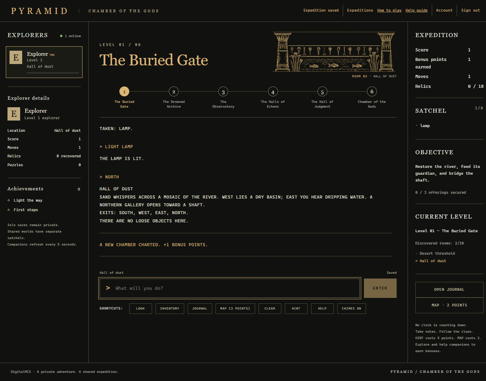
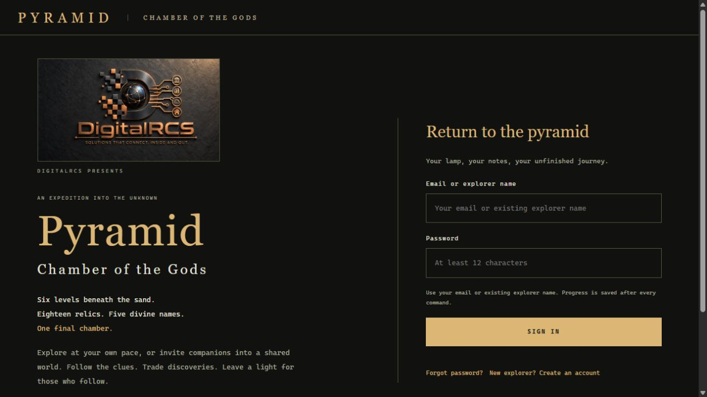

# Pyramid · Chamber of the Gods

A text adventure beneath the sands. Six levels, eighteen relics, and one final puzzle in the Chamber of the Gods.

[Play in your browser](https://digitalrcs.com/pyramid/) · [Player guide](docs/Player-Guide.md) · [Wiki](https://github.com/digitalrcs/PyramidGame/wiki) · [Build locally](docs/Development.md)



Pyramid brings the deliberate pace of a classic text adventure to the web: read the room, try a command, keep notes, and work out what the pyramid is hiding. Gold pixel reliefs, a scrolling transcript and a restrained interface keep the focus on exploration.

Play alone or invite companions into a shared expedition. Split up at a crossroads, meet again to compare clues, and pass an item to the explorer who needs it. Everyone keeps a separate location and satchel; the world remembers what the group has accomplished.

## Inside the pyramid

- **Six connected levels.** Explore 60 rooms across the Buried Gate, Drowned Archive, Observatory, Halls of Echoes, Hall of Judgment and Chamber of the Gods.
- **Shared expeditions.** Invite named explorers or approve requests to join. Companions can arrive later, and an absent player remains in a trance until returning.
- **Persistent progress.** Solo and shared adventures save after commands. Locations, inventory, discoveries and achievements survive sign-out.
- **Maps you earn.** Reveal only the rooms you have visited. A map costs two points; a hint costs five. Exploration and cooperation offer bonus points.
- **Room illustrations and sound.** Sixty gold pixel scenes accompany the text. Optional chimes draw attention to things worth investigating.
- **New worlds in JSON.** Add content packs, puzzles and portals without rebuilding the core campaign.



## Start exploring

Open the [live game](https://digitalrcs.com/pyramid/), create an explorer, and begin a solo adventure or shared expedition. For a solo adventure, try:

```text
LOOK
GET LAMP
LIGHT LAMP
NORTH
INVENTORY
JOURNAL
```

`HELP` lists commands. `CLEAR` tidies the transcript without erasing your progress. The [player guide](docs/Player-Guide.md) explains maps, scoring, inventory and the language of the game.

## Run locally

You will need the **.NET 10 SDK**, **Node.js 22 LTS (22.12 or newer)**, and **Python 3** for the original terminal edition and HTTP test scripts.

```sh
git clone https://github.com/digitalrcs/PyramidGame.git
cd PyramidGame
npm ci --prefix Pyramid.Web/Client
npm run build --prefix Pyramid.Web/Client
dotnet run --project Pyramid.Web -- --urls http://localhost:5188 --environment Development --Pyramid:PathBase /pyramid
```

Visit `http://localhost:5188/pyramid/`. Local data is created in `Pyramid.Web/App_Data` and is excluded from Git. Mail delivery needs separate configuration; no email credentials are included.

On Windows, `BUILD-WEB.ps1` builds the client, runs the .NET checks and creates a publish directory. `RUN-WEB.ps1` starts the local server.

The separate Python adventure is also preserved:

```sh
python pyramid2000.py
```

## Documentation

| Read this | For |
| --- | --- |
| [Player guide](docs/Player-Guide.md) | Commands, inventory, maps, scoring and achievements |
| [Shared expeditions](docs/Multiplayer.md) | Invitations, shared worlds and exchanging discoveries |
| [Content packs and portals](docs/Modding.md) | Building additional adventures in JSON |
| [HTTP API](docs/API.md) | Sessions, commands and integration endpoints |
| [Accounts and email](docs/Accounts-and-Email.md) | Recovery, notifications and administration |
| [Development](docs/Development.md) | Project layout, builds and tests |
| [Deployment](docs/Deployment.md) | IIS, Linux/nginx, backups and recovery |
| [Developer walkthrough — spoilers](docs/Developer-Walkthrough.md) | Campaign solutions and acceptance checks |

The same guides are available in the [GitHub wiki](https://github.com/digitalrcs/PyramidGame/wiki). Markdown sources are kept in `docs/` and `wiki/` so documentation changes can be reviewed alongside the code.

## Project structure

```text
Pyramid.Web/            ASP.NET Core host, game rules and SQLite storage
  Client/               React interface and public artwork
  ContentPacks/         JSON adventures and portals
  Game/                 Campaign, exploration and co-op engines
Pyramid.Tests/          Engine, storage, account and HTTP checks
deploy/                Service, nginx and backup templates
docs/                  Guides and screenshots
wiki/                  GitHub wiki sources
pyramid2000.py         Standalone Python adventure
```

The web edition uses ASP.NET Core 10, React 19, Vite and SQLite. It supports deployment beneath a URL prefix such as `/pyramid/`. See [SECURITY.md](SECURITY.md) for deployment boundaries and reporting guidance.

## Checks

```sh
dotnet run --project Pyramid.Tests -c Release
python -m unittest test_pyramid2000.py
```

HTTP checks run against a separate local test instance; see the [development guide](docs/Development.md). Never run account-creation or mutation tests against a public game.

## Background

Inspired by Robert Arnstein's *Pyramid 2000* for the Radio Shack TRS-80, this project preserves a Python recreation and develops a larger web interpretation. It is an independent tribute, not an official release or a verbatim port.

DigitalRCS branding and the historical game's names remain the property of their respective owners. No redistribution license has been selected for this repository; see [NOTICE.md](NOTICE.md).
